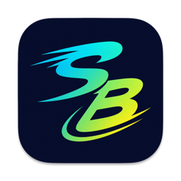

<div align="center">



# Switchboard

**Stop running one coding agent at a time.**

Switchboard is a macOS cockpit for a whole team of coding agents. Claude Code,
Codex, and OpenCode each work in parallel, on their own branch, in their own git
worktree, and take their work all the way to a merged pull request.

[**Download the latest release**](https://github.com/Recombix/switchboard-releases/releases/latest) ·
[Install](#install) · [Requirements](#requirements)

</div>

---

## One agent is a bottleneck

You give an agent a task. You wait. You give it the next one. Meanwhile four
other things on your list sit untouched, because a second agent in the same
checkout would trample the first.

Switchboard fixes the checkout problem, and then builds a cockpit around it.
Every task gets a real git worktree on a real branch. Five agents can be
mid-refactor at once, and none of them can see or break each other's work.
When they finish, Switchboard carries each one through review, CI, and merge.

## What you get

**Genuine isolation.** One branch, one worktree, one agent. No stashing, no
"wait, who changed this file?", no half-finished work bleeding between tasks.
If an agent wanders onto the wrong branch, Switchboard puts it back.

**Your choice of agent.** Pick Claude Code, Codex, or OpenCode for each task,
and set how hard it thinks. Start a task to build, debug, propose solutions,
answer a question, file issues, review a PR, or start blank on any PR's branch.

**The whole fleet at a glance.** Live status on every agent: which are working,
which are asking you something, which are blocked, and which have finished and
want reviewing. See each agent's subagents and to-do list, what each task has
cost, and how much of your Claude and Codex usage is left, right in the menu bar.

**From issue to merged PR.** Start a task from a GitHub or GitLab issue, or a
batch of them. Give a task a queue of issues and it works through them one PR at
a time. Set up a Dispatcher and labelled issues turn into running tasks on their
own, held back by queue and usage limits. An agent can even hand queued issues
to fresh tasks that run beside it.

**Pull requests that look after themselves.** Choose Draft Only, Manual Merge,
or Auto Merge for the whole app, a project, or one task. The Work tab shows each
task's issues, PRs, review threads, and CI checks, with a countdown to green.
Conflicts and stale branches come with a one-click rebase, and a failed merge
goes straight to the agent to fix.

**Review in both directions.** Select text in a diff, a file, or a document, or
pin a comment to a point on an image, and send it all to the agent as one
review. Approve a spec or pick between proposed options with buttons under the
document. Point a review agent at any PR and it checks the diff, threads, CI,
dependencies, security, and your repo's `principles.md`, then posts its findings
if you allow it.

**See the work, not a transcript.** Agents open their plans, screenshots, PDFs,
and live previews as tabs beside the session. Markdown renders with diagrams,
focus mode, find, and PDF export.

**Worktrees that arrive ready.** Drop a `.switchboard/config.json` in your repo
and every new worktree sets itself up the same way: install commands, the
`.env` files git never tracked, dev-server tabs already running, the
architecture doc already open, plus the project's merge mode, branch prefix,
and thinking effort.

**Agents that know where they are.** Switchboard hands each session its own MCP
tools and built-in skills, so an agent can look up its task and pull request,
see what its siblings are touching, message other tasks, ask for a review, and
show you its work, instead of guessing from the branch name.

**Run it somewhere else.** Send a task to a remote SSH host, Tailscale
included. The agent runs in tmux so a dropped connection never kills it, and
diffs and previews stream back to your Mac. A running task can move there in
place.

**Built for long days.** Switchboard keeps your Mac awake while agents work,
with a battery floor. A Work Report sums up what you shipped today or this week.
A command palette reaches almost everything, a hotkey terminal drops down over
any app, and `switchboard://new-task` links start a task from a script or doc.

## Install

**Homebrew.** The easy path, and you get updates with it:

```sh
brew tap recombix/tap
brew trust recombix/tap   # newer Homebrew requires trusting third-party taps
brew install --cask switchboard
```

**Direct download.** Grab the `.dmg` from the
[latest release](https://github.com/Recombix/switchboard-releases/releases/latest),
open it, and drag Switchboard to Applications.

Either way, the app keeps itself up to date from there.

## Requirements

- macOS 12 or later on Apple Silicon
- At least one agent CLI: Claude Code, Codex, or OpenCode
- Optional: the `gh` or `glab` CLI for issues, pull requests, and reviews on
  GitHub or GitLab (self-hosted GitLab included)
- Optional: an SSH host for remote tasks
